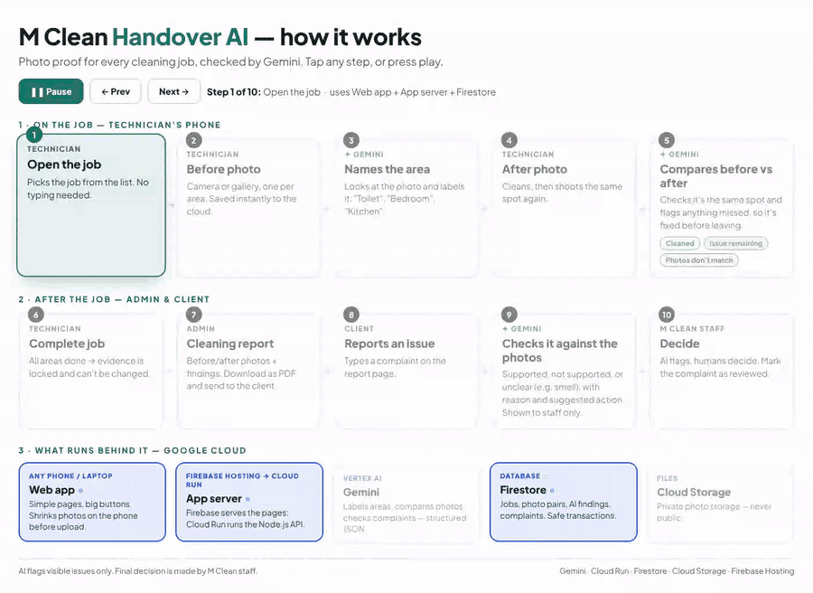
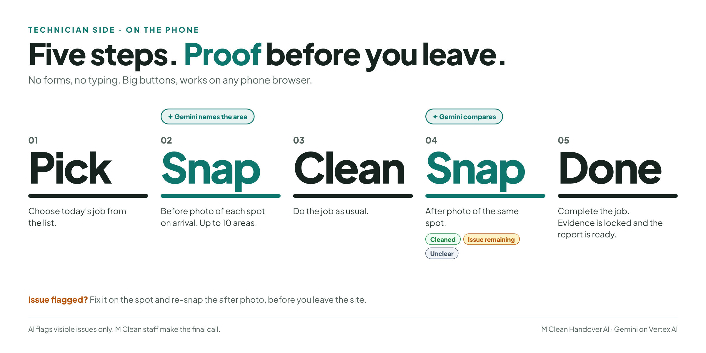
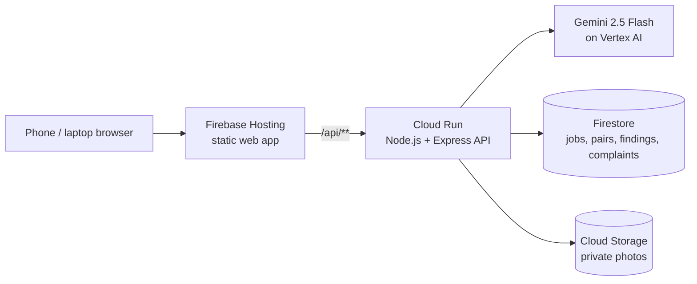

# M Clean Handover AI

**Photo proof for every cleaning job, checked by Gemini.**



**Interactive version (click through each step):** (https://fahmymahamud.github.io/mclean-handover-ai/how-it-works.html)

Cleaning companies and clients often disagree about whether a job was done properly, and handover photos get lost in mixed-up WhatsApp chats. Handover AI gives technicians a fast, simple phone app to prove every job:

1. **Before photo** of each area (camera or gallery). Gemini names the area automatically.
2. **After photo** of the same spot. Gemini compares before vs after and returns **Cleaned**, **Issue remaining**, or **Photos don't match**, so missed spots are fixed before the technician leaves.
3. **Complete job.** Evidence is locked, and the admin downloads a **PDF cleaning report** for the client.
4. **Client feedback.** Complaints are checked by Gemini against the photo evidence (supported / not supported / unclear) and shown only to staff. *AI flags, humans decide.*

**Future of Work & Enterprise Productivity:** moves a cleaning company from mixed-up WhatsApp photos to organised, AI-checked records per job. Built for frontline crews: large buttons, almost no typing, and fast on low-end phones and slow mobile data.

## Google Cloud services
| Service | What it does here |
|---|---|
| **Gemini 2.5 Flash on Vertex AI** | Labels areas, compares before/after photos, checks complaints (structured JSON output) |
| **Cloud Run** | Node.js / Express API |
| **Firestore** | Jobs, photo pairs, AI findings and complaints (with transactions) |
| **Cloud Storage** | Private photo storage |
| **Firebase Hosting** | Serves the web app and routes `/api` calls to Cloud Run |

> AI flags visible issues only. Final decision is made by M Clean staff.

## Live demo
- **Web app (Firebase Hosting):** https://mclean-handover.web.app
- **Interactive walkthrough:** open [`how-it-works`](https://fahmymahamud.github.io/mclean-handover-ai/) in a browser

## Architecture




**How Gemini is used**
| Call | Input | Output (structured JSON) |
|---|---|---|
| Area label | Before photo | `{ areaLabel }` e.g. "Bathroom" |
| Before vs after check | Before + after photo | `{ same_location, result: cleaned \| issue_remaining \| unclear, reason }` |
| Complaint check | Complaint text + all before/after photos | `{ finding: supported \| not_supported \| unclear, areaLabel, explanation, suggested_action }` |

All calls use `responseSchema`, low temperature, validation and one retry. Prompts live in [`src/prompts.js`](src/prompts.js).

## Run locally
```bash
cp .env.example .env              # set GOOGLE_CLOUD_PROJECT, BUCKET_NAME
gcloud auth application-default login
npm install
npm run dev                       # http://localhost:8080
```

## Deploy
```bash
# API (Cloud Run)
gcloud run deploy mclean-handover --source . --region asia-southeast1 \
  --service-account mclean-run@PROJECT_ID.iam.gserviceaccount.com \
  --allow-unauthenticated --min-instances=1 \
  --set-env-vars GOOGLE_CLOUD_PROJECT=PROJECT_ID,GOOGLE_CLOUD_LOCATION=global,GEMINI_MODEL=gemini-2.5-flash,BUCKET_NAME=PROJECT_ID-photos

# Web app (Firebase Hosting, rewrites /api/** to Cloud Run)
firebase deploy --only hosting
```
Full setup (APIs, Firestore, bucket, service account and IAM roles): [`docs/DEPLOY.md`](docs/DEPLOY.md).

## Project structure
```
public/        web app (index.html, app.js, report.html, report.js, style.css)
src/           server.js (Express API), gemini.js, prompts.js, schemas.js, db.js (Firestore), storage.js (Cloud Storage)
scripts/       test scripts for Gemini checks and end-to-end flows
docs/          architecture, data model, deploy guide, how-it-works diagram
firebase.json  Firebase Hosting config with Cloud Run rewrite
```

## Built with
Gemini on Vertex AI · Cloud Run · Firestore · Cloud Storage · Firebase Hosting · Node.js · built with Google Antigravity.

Pilot built for M Clean (Singapore). Test photos used with the company's permission and are not included in this repository.
